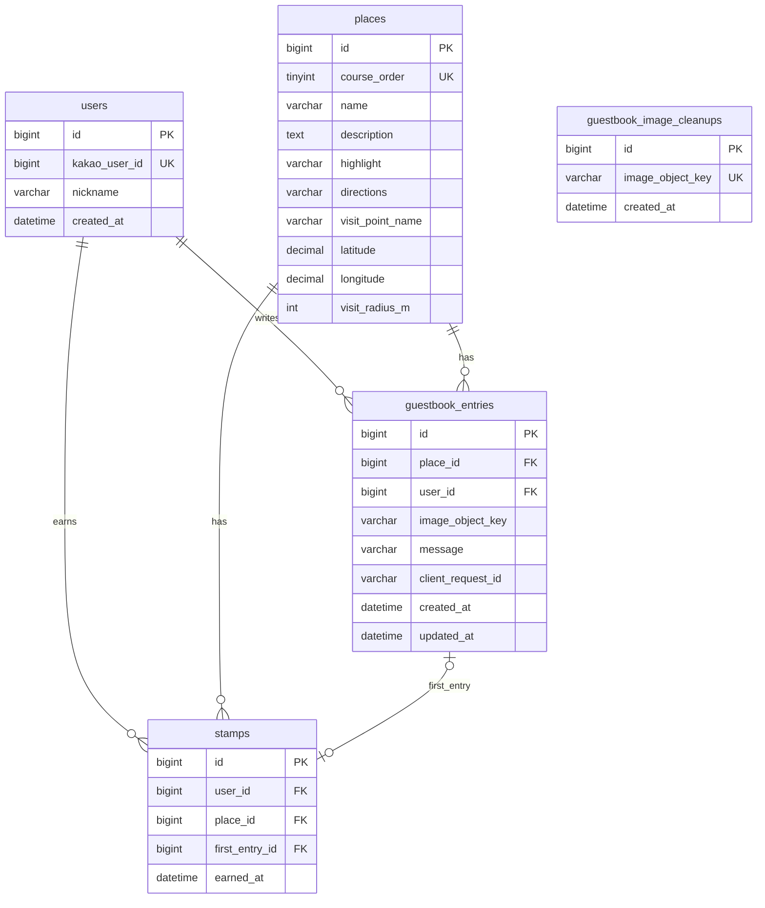

# 왔다감 ERD (MVP 최소안)

PRD v1.2와 백엔드 구현(2026-11-20 develop) 기준, 한 달 일정에 맞춰 테이블 4개로 줄인 설계다. DDL은 `erd.sql` 참고 (ERDCloud Import 가능). **실제 스키마의 정본은 `backend/src/main/resources/db/migration`의 Flyway 파일이다.** V1~V4(users, places, 초기 장소 3곳, stamps)에 이어 V5(`guestbook_entries`, `stamps.first_entry_id` 외래 키 `ON DELETE SET NULL`)와 V6(`guestbook_image_cleanups`)이 구현돼 있다. 시각 컬럼은 `DATETIME(6)`(UTC)이고 `guestbook_entries.image_object_key`도 고유다.

## ERD

## 테이블 설명

| 테이블 | 역할 | 제약·규칙 |
| --- | --- | --- |
| users | 카카오 계정과 닉네임 | `kakao_user_id`(BIGINT) 고유. 닉네임 2~10자(한글·영문·숫자), 설정 전에는 NULL |
| places | 투어 장소 3곳(310관·도서관·청룡연못, 고정 데이터, 장소 사진은 앱에 포함) | `course_order` 고유. 방문 반경은 장소별(310관 75m, 도서관 40m, 청룡연못 30m) |
| guestbook_entries | 공개 방명록 | 모두 전체 공개(공개 범위 컬럼 없음). 이미지는 OCI 객체 키(`image_object_key`, `guestbook/<UUID>.jpg`)만 저장. 메시지 최대 80자. AR·일반 촬영 구분은 저장하지 않음 |
| stamps | 장소별 도장 | (user_id, place_id) 고유. 사용자당 장소별 1개(현재 최대 3개) |
| guestbook_image_cleanups | 방명록 행은 삭제됐지만 OCI 이미지 삭제가 끝나지 않은 객체 키 | 다른 테이블과 외래 키가 없다. 삭제가 성공하면 행을 지우고, 서버가 5분마다 재시도한다 |

## 핵심 규칙

- **중복 업로드 방지:** `guestbook_entries`의 (user_id, client_request_id)가 고유다. 같은 값으로 재시도하면 기존 결과를 반환한다.
- **도장 지급:** 방명록 저장과 최초 도장 생성을 한 트랜잭션으로 처리한다. 이미 도장이 있는 장소는 새로 만들지 않는다.
- **방명록 삭제:** 도장은 유지한다. `stamps.first_entry_id`만 NULL이 된다(`ON DELETE SET NULL`). 이미지 키는 같은 트랜잭션에서 `guestbook_image_cleanups`에 보존한 뒤 서버가 OCI 이미지를 삭제하고, 실패하면 주기적으로 재시도한다. 탈퇴는 모든 이미지 삭제를 확인한 뒤 방명록 행과 사용자를 지운다.
- **수정:** `updated_at`이 `created_at`보다 늦으면 화면에 '수정됨'을 표시한다. 수정으로 도장은 추가되지 않는다.
- **회원 탈퇴:** users를 지우면 방명록·도장이 `ON DELETE CASCADE`로 함께 삭제된다. OCI 이미지는 서버가 삭제한다(탈퇴는 모든 이미지 삭제를 확인한 뒤 DB를 정리).
- **시간:** 서버 기준 UTC로 저장하고 화면에서 한국 시간으로 변환한다.
- **갤러리 조회:** `(place_id, created_at, id)` 인덱스로 장소별 최신순 페이지를 조회한다.

## 이번 ERD에서 뺀 것

| 항목 | 이유 |
| --- | --- |
| 알림 | 기능 삭제 |
| 초안(작성 중) | 기기 로컬 저장 가정. 서버 저장으로 정하면 draft 테이블 추가 |
| 신고 | 기능 제외 |
| 방문 기록(visits) | 업로드 때 GPS를 다시 검증하고 도장은 stamps로 처리하므로 불필요. 방문 장소 수를 따로 보여줄 때만 추가 |
